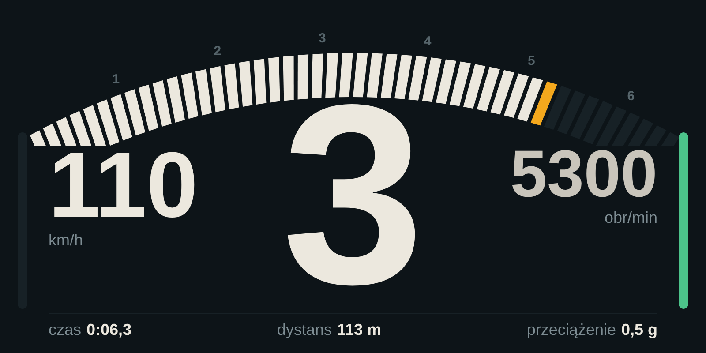
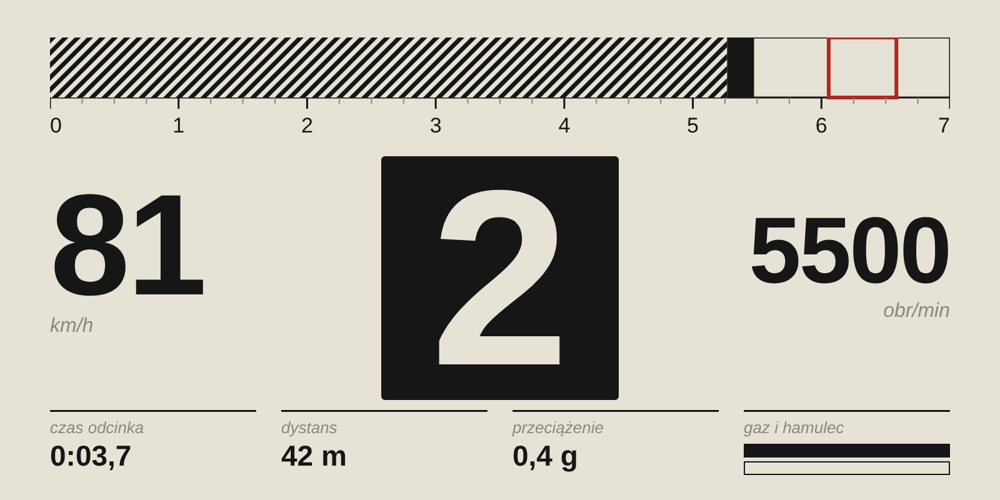
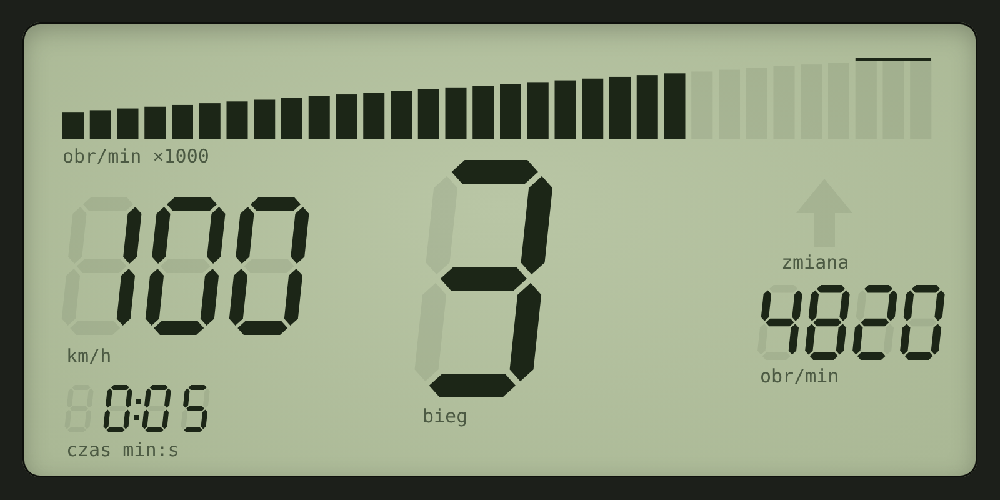

# codriver

A racing-game dashboard for your phone, tablet or second monitor.
Speed, RPM, gear and shift lights – in the browser, no app to install.


Six looks to choose from; every device remembers its own.

|  |  |  |
|---|---|---|
| Odcinek (stage) | Papier (paper) | LCD |

Works with **DiRT 3**. **DiRT Rally** uses the same telemetry format – support is waiting for a real-world test.

## Getting started

1. **Turn on telemetry in the game.** In `Documents\My Games\DiRT3\hardwaresettings\hardware_settings_config.xml` set:
   ```xml
   <motion enabled="true" ip="127.0.0.1" port="20777" delay="1" extradata="3" />
   ```
   (or let codriver do it: the **DiRT 3** card in the panel, or `codriver --telemetry on`).
2. **Run codriver** on the same PC: download `codriver-vX.Y.Z.exe` from [Releases](https://github.com/jakubprill/codriver/releases)
   and double-click it, or from source: `bun src/main.js --open` (`node src/main.js --open` works too, Node 18+).
   The panel opens in your browser.
3. **Connect your phone:** scan the QR code in the panel (or in the codriver window), or open **`http://codriver.local`**.
   The phone must be on the same Wi-Fi; when Windows asks about the firewall, allow private networks.
   Data shows up once a stage starts.

   `codriver.local` works on iPhone, iPad and computers; on some Android phones use the IP address from the QR code.

> **DiRT 3 Complete Edition** with telemetry enabled may show a “sendto failed 10038” error at the finish line – a known game bug.
> codriver can switch telemetry off when you play without the dashboard, and its **Launch DiRT 3** button starts a community fix
> together with the game. Details: [docs/telemetry/codemasters.md](docs/telemetry/codemasters.md).

Without the game: `bun run replay` plays back a recorded drive, and `http://localhost/?demo` shows sample data.

## For developers

No dependencies – all you need is [Bun](https://bun.sh) or Node 18+.
`bun test` runs the tests, `bun run build:windows` builds `codriver.exe`.
How to add a game or a look: [docs/architecture.md](docs/architecture.md).

The user interface is in Polish for now.

## License

[Unlicense](LICENSE) – public domain. Copy it, change it, use it for anything.
