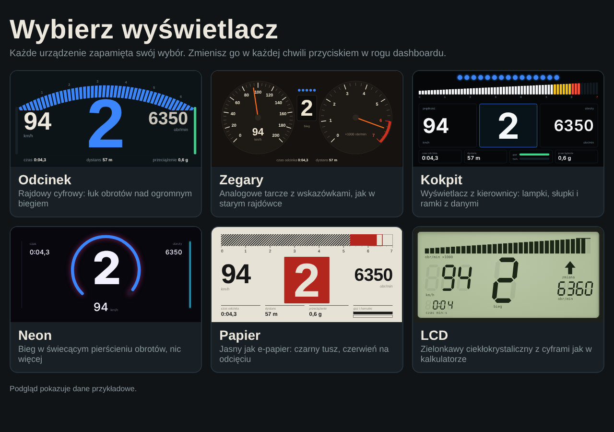
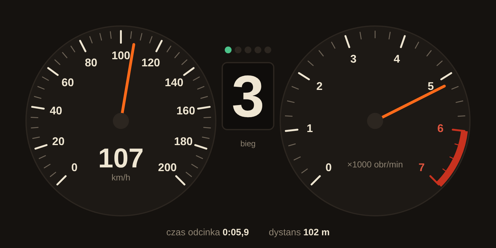
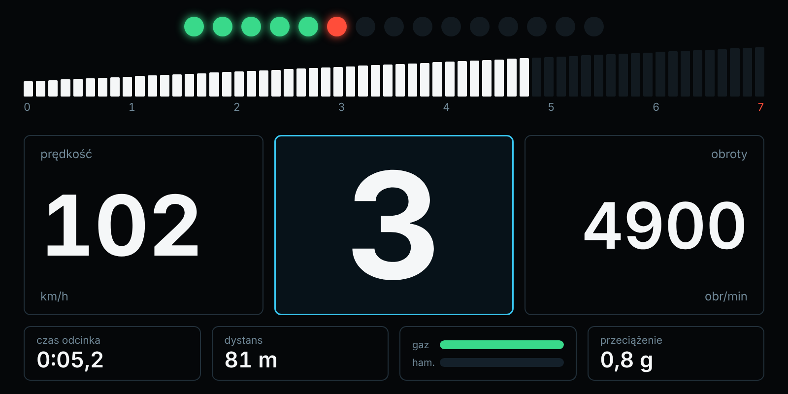
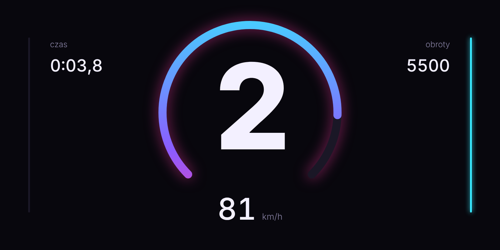

# codriver

Dashboard telemetrii z gier wyścigowych na drugi monitor, telefon albo tablet.
Gra wysyła dane przez UDP, codriver odbiera je na komputerze i pokazuje w przeglądarce
na każdym urządzeniu w tej samej sieci Wi-Fi – bez instalowania aplikacji na telefonie.



**Obsługiwane gry:** DiRT 3 (sprawdzone na nagraniu z jazdy), DiRT Rally (ten sam format Codemasters, do potwierdzenia w praktyce).

## Wyświetlacze

Każde urządzenie zapamiętuje swój wybór, więc każdy domownik może mieć inny.

| | | |
|---|---|---|
|  **Odcinek** – rajdowy cyfrowy |  **Zegary** – analogowe tarcze |  **Kokpit** – jak na kierownicy |
|  **Neon** – tylko najważniejsze |  **Papier** – jasny jak e-papier |  **LCD** – cyfry siedmiosegmentowe |

Na wszystkich lampki zmiany biegu zapalają się w tym samym momencie: od 80% maksymalnych obrotów
bursztyn, od 92% czerwień, od 96,5% cały wskaźnik miga na niebiesko – zmieniaj bieg.

## Uruchomienie

### 1. Włącz telemetrię w grze (raz)

W `Dokumenty\My Games\DiRT3\hardwaresettings\hardware_settings_config.xml`
(przy OneDrive: `OneDrive\Dokumenty\…`) ustaw linię `motion`:

```xml
<motion enabled="true" ip="127.0.0.1" port="20777" delay="1" extradata="3" />
```

Szczegóły i DiRT Rally: [docs/telemetry/codemasters.md](docs/telemetry/codemasters.md).

### 2. Uruchom codriver

- **Gotowy plik:** pobierz `codriver.exe` ze strony [Releases](../../releases) i uruchom (skrót na pulpicie wystarczy).
- **Z kodu:** `scripts\start.bat` albo `bun src/main.js --open` (działa też `node src/main.js`).

Okno pokaże adres, np. `http://192.168.8.126:8080` – wpisz go w przeglądarce telefonu.
Przy pierwszym uruchomieniu Windows zapyta o zaporę: zezwól dla **sieci prywatnej**.
Dane pojawiają się po starcie odcinka (w menu gra nic nie wysyła).

### 3. Na telefonie

Dotknięcie ekranu włącza pełny ekran; przycisk „Zmień wygląd” pojawia się w rogu po dotknięciu.
Ustaw dłuższy czas wygaszania ekranu – przeglądarka nie pozwala go zablokować na zwykłym http.

## Rozwój

```sh
bun run dev            # serwer z przeładowaniem (node --watch)
bun run replay         # odtwarza nagranie z jazdy w pętli – dashboard bez gry
bun test               # testy parsera (działa też: node --test)
bun run build          # dist/codriver – jeden plik z serwerem i interfejsem
bun run build:windows  # dist/codriver.exe
```

Podgląd bez gry i bez serwera danych: `http://localhost:8080/?demo`.
Wymuszenie motywu: `?theme=papier`, ekran wyboru: `?pick`.

Jak to jest zbudowane i jak dodać grę albo wygląd: [docs/architecture.md](docs/architecture.md).

## Wersje

Numer wersji jest w `package.json`. Wydanie: podbij wersję, zrób commit, `git tag v0.2.0 && git push --tags` –
GitHub Actions zbuduje `codriver.exe` i opublikuje go w Releases.
